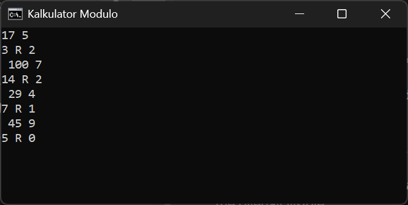

# Kalkulator Modulo

A small C program that repeatedly reads two integers and prints the quotient and remainder of their integer division.



## Example
```
17 5
3 R 2
```

## Features
- Integer division (`/`) and modulo (`%`)
- Loops until a divisor of zero is entered, which prints an error and exits

## Build and run
The project file is for Code::Blocks (`KalkulatorModulo.cbp`). You can also build it with GCC:

```bash
gcc main.c -o modulo.exe
modulo.exe
```

## License
Released under the [MIT License](LICENSE).
